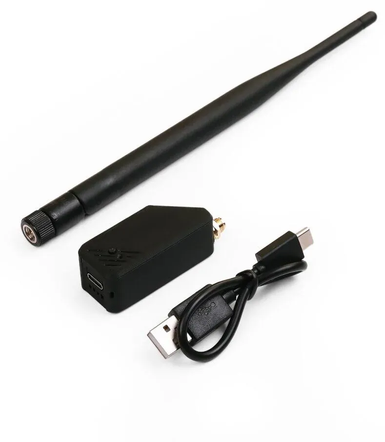

# XIAO ESP32S3 LoRaWAN Temperature Sensor

This project is a low-cost, hands-on example of setting up the [XIAO ESP32S3 + Wio-SX1262 LoRa kit](https://www.seeedstudio.com/XIAO-ESP32S3-for-Meshtastic-LoRa-with-3D-Printed-Enclosure-p-6314.html) as a LoRaWAN end device. The example firmware joins TTN using OTAA and sends the ESP32's internal chip temperature—not ambient temperature. The ESP32 also makes the kit easy to extend with other sensors or actuators.

## Requirements

### Hardware

- Seeed Studio XIAO ESP32S3 for Meshtastic LoRa kit, with its Wio-SX1262 board
- The kit's LoRa antenna, connected to the SX1262 before powering the radio
- USB-C **data** cable and a computer for flashing
- A single-cell LiPo battery only if battery operation is needed; USB power is sufficient for setup
- A TTN-compatible LoRaWAN gateway reachable in the device's region (EU868 is configured in this project)

The kit uses a board-to-board (B2B) connector. Seat the XIAO and Wio-SX1262 together as designed; do not substitute the Wio-SX1262 board intended for the XIAO nRF52840. Attach the LoRa antenna before transmitting. See [Seeed's kit guide](https://wiki.seeedstudio.com/wio_sx1262_with_xiao_esp32s3_kit/) for the board and antenna details.

### Software and accounts

- [Arduino CLI](https://arduino.github.io/arduino-cli/) (for example `brew install arduino-cli` on macOS)
- `make` and `python3`
- A [The Things Network account](https://www.thethingsnetwork.org/)

You do not need to install the ESP32 toolchain or RadioLib manually; `make setup` installs them.

## Install and register the device

### 1. Install the build dependencies

1. Install [Arduino CLI](https://arduino.github.io/arduino-cli/latest/installation/).
2. From the project folder, run `make setup`. This installs the ESP32 Arduino core (3.3.8) and RadioLib 6.6.0, pinned in the `Makefile`.

### 2. Assemble and connect the kit

Fit the Wio-SX1262 to the XIAO ESP32S3 using its B2B connector. Connect the kit's LoRa antenna, then connect the XIAO to your computer using a USB-C data cable. Keep the antenna attached whenever the radio is powered and transmitting.

### 3. Create a TTN application

1. Sign in to the [TTN Console](https://console.cloud.thethings.network/) and select the cluster for your region.
2. Open **Applications** and choose **+ Create application**.
3. Enter an application ID (for example, `xiao-temperature`) and create the application.

You need a gateway connected to the same TTN cluster and using the frequency plan for your region. The firmware as provided is configured for **EU868**: it starts the radio at 868.1 MHz and uses the EU868 LoRaWAN region. Do not use these settings in another region without changing the firmware and matching its TTN frequency plan to local regulations.

### 4. Register an OTAA end device in TTN

1. In your application, open **End devices** and choose **+ Register end device**.
2. Choose **Enter end device specifics manually**. If the UI offers a device repository instead, manual configuration is appropriate for this custom firmware.
3. Select the **Europe 863-870 MHz** frequency plan (the TTN option may be labelled “SF9 for RX2 - recommended”).
4. Set the LoRaWAN MAC version to **1.1.0**. The firmware supplies both an `NwkKey` and an `AppKey` through RadioLib's OTAA interface. Select the matching regional-parameters version offered by TTN (typically **RP001 1.1.0-B**).
5. Generate a **JoinEUI** and **DevEUI** in TTN (or enter identifiers allocated to your device). They must match the values you later configure in the firmware.
6. In TTN, generate an **AppKey** and **NwkKey** for the device. Copy each key exactly as shown into the quoted `appKeyHex` and `nwkKeyHex` strings in `firmware/secrets.h`. Do not add spaces, commas, or `0x` prefixes; each value must be 32 hexadecimal characters. The firmware converts each pair of hex digits into the 16 key bytes RadioLib expects.
7. Give the end device a unique lowercase **End device ID** (for example, `xiao-temperature-01`) and register it.

**Protect the keys.** Do not commit `firmware/secrets.h` or share a firmware image built with your device's credentials. This repository ignores that local file. If credentials from an earlier version of this project have already been committed or shared, revoke/replace them in TTN before deploying. If this firmware has already attempted to join with a previous identity, do not erase its saved LoRaWAN nonce state or reuse that identity with new keys; nonce persistence is required for safe OTAA operation.

### 5. Configure credentials

1. Copy `firmware/secrets.example.h` to `firmware/secrets.h`.
2. Edit `firmware/secrets.h`: enter the same JoinEUI and DevEUI registered in TTN, and replace the example values in `appKeyHex` and `nwkKeyHex` with the corresponding TTN keys.
3. Keep the EU868 region and radio pin definitions in `firmware/config.h` unchanged for this exact kit and EU868 deployment.

The keys can be pasted directly in their TTN hexadecimal format, with no manual byte conversion. The EUI values are 64-bit hexadecimal numbers; retain all 16 digits, including any leading zeroes. `firmware/secrets.h` is excluded by `.gitignore`; keep the template `firmware/secrets.example.h` free of real credentials.

### 6. Build and flash the firmware

1. Run `make build` to compile the firmware.
2. Connect the XIAO by USB-C and run `make upload`. The serial port is detected automatically; if not, pass it explicitly, for example `make upload PORT=/dev/cu.usbmodem1101`.
3. Run `make monitor` to view startup and join messages (115200 baud).

If the board does not appear as a serial port or upload does not start, try another USB data cable and port. Put the XIAO into its USB bootloader mode using its BOOT/RESET controls, then retry the upload.

### 7. Confirm the OTAA join and uplinks

After startup, the serial monitor should report radio initialization and attempt to join TTN. A successful join is reported as **Joined TTN!**. Then the device sends an unconfirmed, two-byte temperature uplink on **FPort 1**, with a nominal interval of 10 minutes; regional airtime limits can make the interval longer. It uses the ESP32's on-chip temperature reading, which is not a calibrated ambient-temperature sensor.

In TTN, open the end device's **Live data** tab. Look for a join event followed by uplink events. TTN gateway coverage is required for both the join and uplinks. An uplink can be received without a downlink; “no downlink received” is normal for this unconfirmed sensor.

### 8. Decode the temperature in TTN

To see the reading as a number instead of raw bytes:

1. Open the application's **Payload formatters** and select the **Uplink** formatter.
2. Choose **Custom Javascript**.
3. Paste the contents of [`firmware/ttn_payload_formatter.js`](firmware/ttn_payload_formatter.js) and save.
4. Reopen the end device's Live data. Decoded uplinks contain `temperature_c`.

The payload is a signed 16-bit integer in big-endian order, representing hundredths of a degree Celsius. For example, a payload of `09 C4` decodes to `25.00 °C`.

## Troubleshooting

- **Radio initialization fails:** Check that the Wio-SX1262 B2B connector is fully seated, the kit's radio antenna is attached, and the configured board is the XIAO ESP32S3/Wio-SX1262 combination.
- **OTAA join does not succeed:** Verify TTN gateway coverage and matching frequency plans, JoinEUI, DevEUI, AppKey, NwkKey, LoRaWAN version, and region. Use TTN Live data to inspect join-request and join-accept events. Avoid rapid repeated restarts; the firmware bounds retries and backs off between attempts.
- **The monitor shows nonce or stored-state errors:** Do not erase flash or disable TTN nonce checks. The firmware stores join nonce history in ESP32 nonvolatile storage and relies on it to avoid invalid OTAA joins.
- **No temperature appears in decoded data:** Confirm an uplink is present, the uplink formatter is saved, and the payload has exactly two bytes on FPort 1.

## Project files

- `Makefile` — setup, build, upload, and monitor commands using Arduino CLI
- `firmware/firmware.ino` — LoRaWAN OTAA, persistent join nonces, sleep, and temperature uplinks
- `firmware/config.h` — radio pin map, region, timing, and credentials include
- `firmware/secrets.example.h` — template for the ignored local `firmware/secrets.h` credentials file
- `firmware/ttn_payload_formatter.js` — TTN uplink decoder
